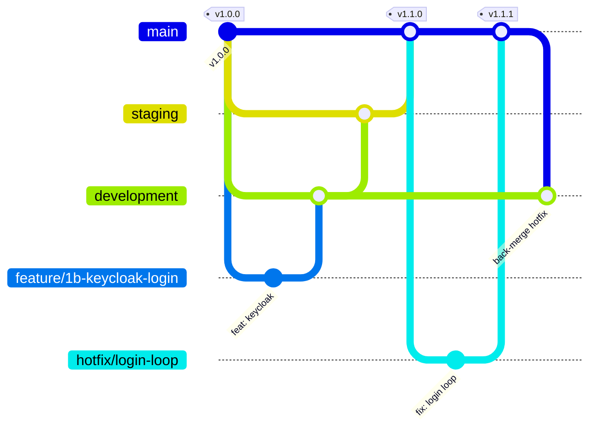

# Branching and release flow

## Branches

| Branch | Purpose | Deploys to | Who merges into it |
|---|---|---|---|
| `main` | What runs in **production** | Production (manual approval) | `staging` (release) or `hotfix/*` |
| `staging` | Release candidate, tested like prod | Staging | `development` |
| `development` | Integration of finished features | Dev | `feature/*`, back-merges from `main` |
| `feature/<short-name>` | One feature or increment | Nothing (CI only) | Developers |
| `hotfix/<short-name>` | Urgent production fix | Nothing (CI only) | Cut **from `main`** |

## The normal flow

1. `git switch development && git pull`
2. `git switch -c feature/1b-keycloak-login`
3. Commit, push, open a PR **into `development`**. CI must pass, plus 1 review.
4. When `development` is ready for a release: PR **`development` → `staging`**. Test on staging.
5. When staging is approved: PR **`staging` → `main`**, then tag `vX.Y.Z`. Production deploys after manual approval.

## The hotfix flow (a separate path, never through development)

1. `git switch main && git pull && git switch -c hotfix/<what>`
2. Fix, PR **into `main`**. CI + review, then tag `vX.Y.Z+1`, deploy.
3. **Back-merge** `main` → `development` (and `staging` if a release is in flight), so the fix isn't lost
   in the next release.

## Rules

- Never commit directly to `main`, `staging` or `development`. Everything goes through a PR.
- Conventional commits: `feat:`, `fix:`, `docs:`, `chore:`, `refactor:`, `test:`.
- Squash-merge feature PRs; use merge commits for `development` → `staging` → `main`, so release
  history stays readable.
- Delete the feature branch after merge.

## GitHub settings (one-time, by the repo owner)

**Settings → Branches → Add branch ruleset** for `main`, `staging` and `development`:
- Require a pull request before merging (1 approval for `staging` and `main`).
- Require status checks to pass: `.NET build + test`, `Angular test + build`.
- Block force pushes. Restrict deletions.
- `main` only: restrict who can push to the owner, and require linear history off (release
  merges are merge commits).

**Settings → Environments:** `dev`, `staging`, `production`. Give `production` *Required
reviewers* = you. Deployment workflows are added in the Azure increment.
